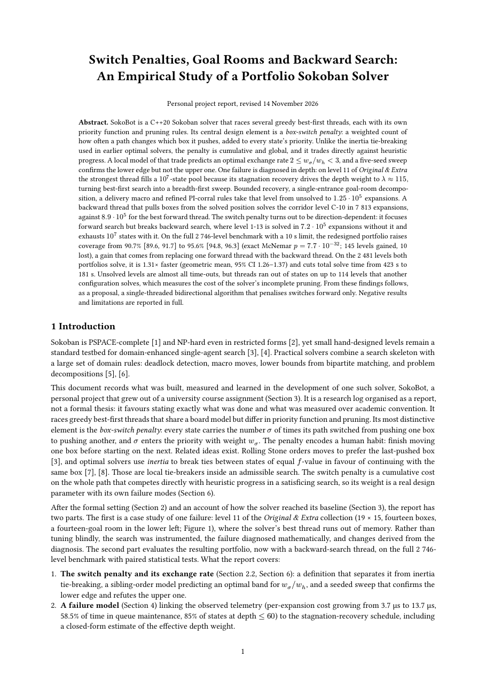

# SokoBot

SokoBot is a Sokoban solver with C++20 search engines and a web UI. Several solvers can live side by side, and the UI toggles between them.

## Report

The full write-up of the project is a 24-page PDF: **[Switch Penalties, Goal Rooms and Backward Search: An Empirical Study of a Portfolio Sokoban Solver](paper/main.pdf)**.

[](paper/main.pdf)

The report documents what was built, measured, and learned. It covers these topics:

- **Development history.** How the solver went from a Java course project to the current four-thread portfolio, including the decisions that later turned out wrong.
- **The box-switch penalty.** A cost for changing which box the search pushes. The report models its exchange rate against heuristic progress and tests the model with a seeded sweep.
- **A failure analysis of level 1-11.** The stagnation recovery turned best-first search into a breadth-first sweep. Bounded recovery, a goal-room macro, a delivery macro, and corral refinements take the level from unsolved to about 125,000 expansions.
- **Backward search.** A thread that pulls boxes from the solved position. It solves level C-10 in 7,813 expansions, against 888,360 for the best forward thread. The switch penalty helps forward search and breaks backward search.
- **The full benchmark.** On 2,746 levels with a 10 s limit, replacing one forward thread with the backward thread raises coverage from 90.7% to 95.6%.
- **Limitations and negative results.** The report lists what was not measured and which ideas failed.

The source is `paper/main.typ`. To rebuild the PDF, install [Typst](https://typst.app) and run these commands in `paper/`:

```
python3 make_figures.py      # redraw the figures from paper/data/
typst compile main.typ       # write main.pdf
```

## System overview

The main **solver** is the C++20 search engine in `solvers/portfolio/`. More solvers sit beside it in `solvers/`. The **core system** is the shared TypeScript package in `core/`. It holds the domain logic and the service APIs. The **web UI** in `web/` calls the core system. It contains no search logic.

Read `docs/architecture.md` for the module design. Read `docs/solver-algorithms.md` for the search algorithms. Read `docs/telemetry.md` for the profile files.

## Prerequisites

1. Install [Bun](https://bun.sh) 1.3 or later.
2. Install a C++20 compiler and `make`. On macOS, install LLVM with Homebrew. On Linux, install `g++`. On Windows, install MinGW and `mingw32-make`.
3. Run `bun install` in the repository root.

## Commands

Run every command from the repository root.

| Command | Action |
| --- | --- |
| `bun run build` | Compile every solver in `solvers/`. `portfolio` also builds `sokotrace` and `sokobench` |
| `bun run dev` | Build the solvers, then serve the web UI with hot reload |
| `bun run serve [port]` | Serve the web UI with hot reload |
| `bun run start [port]` | Build the web UI into one HTML file and serve it |
| `bun run solve <map>` | Solve one map with `portfolio` and export telemetry files to `data/` |
| `bun run solve <map> --summary` | Solve one map and print a static summary |
| `bun run solve <map> --showcase` | Solve one map without telemetry |
| `bun run bench [seconds] [out.csv]` | Benchmark every map |
| `bun run typecheck` | Typecheck `core/` and `scripts/` |
| `bun run clean` | Remove every solver build |

## Adding a solver

Each folder in `solvers/` with a `Makefile` is a solver. The web UI lists them in the Bot panel and Solve runs the one you pick. `bun run build` compiles all of them.

The repository ships these solvers:

| Folder | Solver |
| --- | --- |
| `portfolio` | The main C++20 solver: a race of search threads, with an Explorer |
| `experiments` | The portfolio as it was before the backward-search thread, with an Explorer |
| `simplified` | The first single-file C++ rewrite, with deadlock checks and a Manhattan heuristic |
| `classic` | The eight-thread C portfolio from the first version of the project |
| `asm` | An x86-64 NASM solver, Linux only |
| `rust` | A Rust push-based search with Hungarian matching |
| `java` | A greedy push search with deadlock detection. Linux and macOS |
| `python` | The same idea in pure Python with numpy and scipy. Linux and macOS |

A solver reads a map on stdin. By default it prints a time in milliseconds on the first line and the moves on the second. Optional `solver.json` in the folder:

| Key | Meaning |
| --- | --- |
| `name` | Label in the UI. Defaults to the folder name |
| `solve` | Binary in `bin/`. Default `sokosolve` |
| `trace` | Tracer binary in `bin/`. Without it the solver has no Explorer |
| `targets` | Make targets to build. Default `solve`, plus `trace` when set |
| `args`, `env` | Extra arguments and environment variables for the solve binary |
| `threads` | `true` when the solver reads `SOKO_THREADS`, which shows the thread picker |
| `output` | `moves` when the solver prints only the moves line |
| `platform` | The system, or list of systems, it builds on, as `process.platform`. Other systems skip it. `asm` is `linux` |

Only a solver with a `trace` binary can open the Explorer. Right now that is `portfolio` and `experiments`.

## Repository layout

| Path | Content |
| --- | --- |
| `solvers/` | One folder per solver, each with its own Makefile. `solvers/portfolio/` is the main one. It follows the Google C++ Style Guide. Headers live in `solvers/portfolio/include/soko/`. |
| `core/` | The core system `@sokobot/core`. It holds domain logic, controllers, and engine services. |
| `web/` | The web UI (Svelte 5) and the Hono HTTP server |
| `scripts/` | The command line runner and the `--summary` renderer |
| `docs/` | Technical documentation and audit logs |
| `maps/` | Puzzle files |
| `analysis/` | Benchmark runs in `data/`, statistics (`sokostats`), notebooks, and the `graph.py` plots |
| `paper/` | The project report: Typst source, figures, data, and `main.pdf` |
| `data/` | Telemetry output. Git ignores it. |
